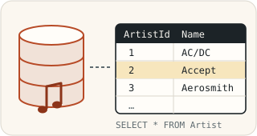
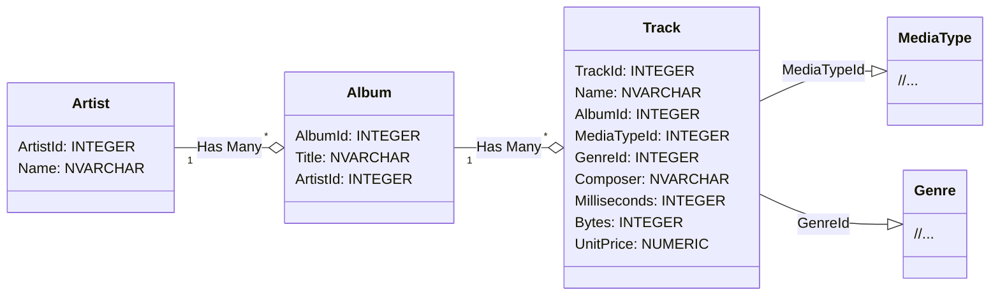
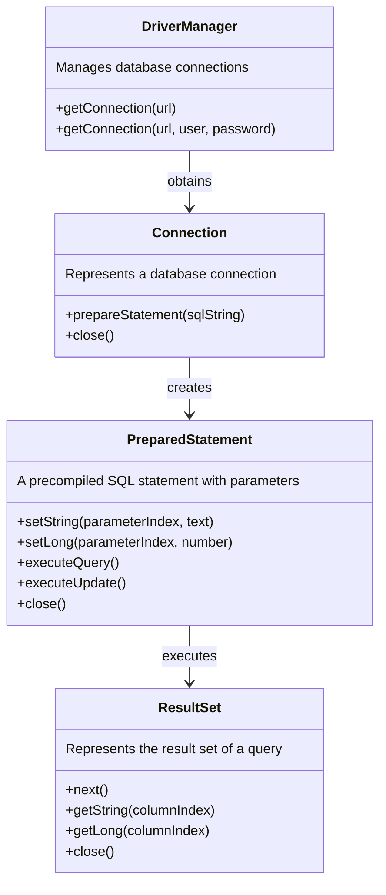

# Using SQL databases with Java



In this exercise, you learn to connect to a database from a Java program and to perform simple CRUD operations (Create, Read, Update & Delete). Along the way, you get familiar with concepts such as JDBC, DAO and PreparedStatement.

## Starting the exercise

First fork this repository into your own GitHub repository with GitHub's **Fork** button, and only then clone your fork to your computer:

```sh
git clone https://github.com/<your-github-username>/7-sql-databases.git
```

Open the cloned project in your code editor.

## Testing

The parts of the exercise have ready-made [JUnit](https://junit.org/) unit tests in the [src/test/java](./src/test/java/) directory. Each part tells which test class grades it. You can run the tests with your code editor's testing tool ([VS Code](https://code.visualstudio.com/docs/java/java-testing), [Eclipse](https://www.vogella.com/tutorials/JUnitEclipse/article.html)) or with [Gradle](https://docs.gradle.org/current/userguide/java_testing.html), for example:

```
./gradlew test --tests JdbcDemoMainTest        # unix
.\gradlew.bat test --tests JdbcDemoMainTest    # windows
```

Add `--info` to the end of the command for more details about failing tests. You do not need to study how the tests are implemented, and you can also try your solution with your own `main` method. You may write more tests of your own, but do not change or remove the given tests.

Do not change the names, parameters or return types of the given classes, methods and constructors, because the tests will then not compile. You get the original version of a file back with `git restore <path to file>` or with the **Palauta lähtökoodi** (restore starter code) function of the course system.

💡 *The tests use a different database than the main program. If needed, study the [TestUtils](./src/test/java/databases/utils/TestUtils.java) class and its database creation statements.*

## Submitting and points

Each part of the exercise has its own page in the course system (https://jtjuslin.kapsi.fi/java), and its code fields contain the part's starter code. Copy your solution into the code fields or write it there directly. **Testaa ilman palautusta** (test without submitting) runs the part's tests without saving points, and **Lähetä** (submit) submits your solution. Each test class is accepted only if all of its tests pass, and the points are divided according to the accepted test classes.

**Points in two stages**

1. When your solution passes in the course system, you get **half of the points** for the part.
2. Finally, push everything to your public GitHub repository. Then press the **Lähetä tarkistettavaksi** (submit for checking) button on the part's page. When the tests pass, you get **full points** for the part. The repository may remain public.

There is no grading YAML workflow (GitHub Actions) on GitHub, and `git push` does not start any grading. When you press **Lähetä tarkistettavaksi**, the course system's bot fetches your code from your repository and checks it with the same tests. Both stages must be completed before the chapter deadline. You can submit as many times as you need, and your best result is kept.


## JDBC – Java Database Connectivity

The [JDBC API](https://docs.oracle.com/javase/8/docs/technotes/guides/jdbc/) of Java's standard library lets Java applications connect to SQL databases and run queries and updates from Java code. Different databases are used through drivers implemented for them, so from the Java code's point of view it makes no difference whether the database is [MySQL](https://www.mysql.com/), [PostgreSQL](https://www.postgresql.org/) or [SQLite](https://www.sqlite.org/index.html), for example.

By default, this exercise uses the file-based **SQLite** database, which needs no separate database server, network connections, passwords or installations. SQLite is embedded into your own application:

> *"In contrast to many other database management systems, SQLite is not a client–server database engine. Rather, it is embedded into the end program."*
>
> [https://en.wikipedia.org/wiki/SQLite](https://en.wikipedia.org/wiki/SQLite)

From the Java program's point of view, SQLite works the same way as database servers, and the SQL queries are mostly the same, for example `SELECT ArtistId, Name FROM Artist`. Despite being lightweight, it is a very significant database that is [used in the most popular web browsers and phones, among others](https://www.sqlite.org/famous.html).

⭐ *You may use a **MySQL** database instead of SQLite if you can install the server and create the database on your own, since the course can give only limited guidance with it. The database creation scripts are in the file [data/Chinook_MySql_AutoIncrementPKs.sql](./data/Chinook_MySql_AutoIncrementPKs.sql). Then uncomment the MySQL driver line in [build.gradle](./build.gradle) and change the connection string of the main program, including the credentials, to match your database.*

### Drivers and dependencies

JDBC drivers, like other dependencies, could be downloaded manually, but managing dependencies is much easier with a build tool such as Gradle. The SQLite and MySQL drivers are already defined in the [build.gradle](./build.gradle) file, from which your code editor can install them:

```groovy
dependencies {
    // SQLite driver: https://mvnrepository.com/artifact/org.xerial/sqlite-jdbc
    implementation 'org.xerial:sqlite-jdbc:3.+'

    // SQLite driver requires a SLF4J logger https://mvnrepository.com/artifact/org.slf4j/slf4j-simple
    implementation 'org.slf4j:slf4j-simple:2.+'

    // MySQL driver: https://mvnrepository.com/artifact/com.mysql/mysql-connector-j
    // Uncomment the following line, if you wish to use a MySQL database:
    // implementation 'com.mysql:mysql-connector-j:8.+'
}
```


## Ready-made music database

The exercise uses the ready-made [**Chinook**](https://github.com/lerocha/chinook-database) music database, whose files are in the [data](./data/) directory of the template:

> *"The Chinook data model represents a digital media store, including tables for artists, albums, media tracks, invoices and customers."*
>
> [Luis Rocha, Chinook Database](https://github.com/lerocha/chinook-database)

The database has many tables and lots of data, but this exercise only uses the `Artist` and `Album` tables:



💡 *You can explore the database with the [SQLite command-line tool](https://sqlite.org/cli.html) or a [graphical user interface](https://www.google.com/search?q=sqlite+gui). If you change the database file by accident, restore it with `git restore data/FILENAME` (on Windows, use `\` instead of the slash).*

More information: [UML diagram](https://github.com/lerocha/chinook-database/wiki/Chinook-Schema), [documentation](https://github.com/lerocha/chinook-database), [SQL creation statements](https://raw.githubusercontent.com/lerocha/chinook-database/master/ChinookDatabase/DataSources/Chinook_Sqlite.sql).


## JDBC basics

Database operations in JDBC are done with three central classes:

* **[Connection](https://docs.oracle.com/javase/8/docs/api/java/sql/Connection.html)** enables the interaction between the application and the database. Creating a connection requires the database details, such as the location of the SQLite file or the server address, username and password. The connection is closed after use so that its resources are released.
* **[PreparedStatement](https://docs.oracle.com/javase/8/docs/api/java/sql/PreparedStatement.html)** runs SQL queries. It sets the query parameters safely, which prevents SQL injection.
* **[ResultSet](https://docs.oracle.com/javase/8/docs/api/java/sql/ResultSet.html)** is the result of a query, organized in rows and columns. It is usually processed in a loop.



Closing resources "manually" with `close()` takes many lines of code. 🚀 *Instead, you can use the [try-with-resources](https://www.baeldung.com/java-try-with-resources) syntax, which closes the resources automatically.*


## Part 1: creating a query and handling the results *(basics, 20 %)*

The main program [JdbcDemoMain](./src/main/java/databases/part01/JdbcDemoMain.java) of the template shows how a connection is created and how queries are run with it. Run it with the Run button of your code editor or with `./gradlew run` (on Windows `.\gradlew.bat run`). The program prints the artists of the database ordered by `ArtistId`:

```
AC/DC
Accept
Aerosmith
Alanis Morissette
Alice In Chains
...
```

💡 *If VS Code gives the error `SQLException: path to 'data/Chinook_Sqlite.sqlite' does not exist`, reopen the project from the "Open Folder..." menu. The database path is relative to the project's root directory, so VS Code must have the directory containing this readme open.*

Make two changes to the main program:

1. **Query:** change the query so that the artists are sorted alphabetically by name.
2. **Handling the results:** after each artist's name, print the artist's id on the same line in the format `Name (id)`:

```
A Cor Do Som (43)
AC/DC (1)
Aaron Copland & London Symphony Orchestra (230)
Aaron Goldberg (202)
Academy of St. Martin in the Fields & Sir Neville Marriner (214)
```

Graded with the test class [JdbcDemoMainTest](./src/test/java/databases/part01/JdbcDemoMainTest.java), which runs the `main` method and examines its output.

Logic based on `System.out.println` calls is hard to test and reuse, because the `main` method returns nothing. A better way is to separate the logic into methods of its own, as is done in the next part. That makes the code more **testable**, **reusable** and **maintainable**.

🚀 *By default, SQLite sorts "AC/DC" before names starting with "Aaron...", because its ORDER BY comparison is case-sensitive. This "almost correct" order is accepted, but you may sort the names case-insensitively with the tips in [this discussion](https://stackoverflow.com/a/2413833).*


## Part 2: object-oriented approach *(basics, 40 %)*

In this part, you use object-oriented programming to divide the database operations into separate classes and methods. Database logic is often separated from the rest of the code with a [design pattern](https://en.wikipedia.org/wiki/Software_design_pattern) called DAO:

> *"A Data Access Object class can provide access to a particular data resource without coupling the resource's API to the business logic."*
>
> Oracle. Data Access Object - Also Known As DAO. https://www.oracle.com/java/technologies/data-access-object.html

The [databases.part02](./src/main/java/databases/part02/) package has three ready-made classes:

* [Artist](./src/main/java/databases/part02/Artist.java) represents a single artist. It is an ordinary class without database or user interface logic (a *model* or *entity*).
* [ArtistDAO](./src/main/java/databases/part02/ArtistDAO.java) mediates between the application and the database: it provides the database operations for artists, so other classes do not need to know any SQL. A DAO class has no user interface logic, such as printing.
* [ArtistAppMain](./src/main/java/databases/part02/ArtistAppMain.java) is a new main program that corresponds to the program of part 1 but uses `ArtistDAO` and contains no database logic at all:

```java
public static void main(String[] args) {
    ArtistDAO artistDAO = new ArtistDAO(JDBC_URL);
    List<Artist> artists = artistDAO.getArtists();

    for (Artist artist : artists) {
        System.out.println(artist.getName() + " (" + artist.getId() + ")");
    }
}
```

Implement the methods `getArtists` and `getArtistById` of the `ArtistDAO` class, whose signatures and Javadoc comments are ready. Use the connection string given to the constructor (`connectionString`), because the tests use their own test database. When the DAO works, `ArtistAppMain` prints the same as the program of part 1.

💡 *Avoid repeating the same code in both methods. You may also write your own classes and helper methods, for example a `Database` class for opening and closing connections, and `getArtistById` may call `getArtists` (efficiency does not matter here).*

Graded with the test class [ArtistDAOTest](./src/test/java/databases/part02/ArtistDAOTest.java).


## Part 3: adding, updating and deleting data *(applying, 40 %)*

In the previous parts, data was fetched with the `executeQuery` method. Now data is added, updated and deleted with the [executeUpdate](https://docs.oracle.com/javase/8/docs/api/java/sql/PreparedStatement.html#executeUpdate--) method. The [Album](./src/main/java/databases/part03/Album.java) and [AlbumDAO](./src/main/java/databases/part03/AlbumDAO.java) classes of the [databases.part03](./src/main/java/databases/part03/) package follow the same model as `Artist` and `ArtistDAO`. Implement the methods of `AlbumDAO` according to their comments:

* `getAlbumsByArtist(Artist artist)`
* `addAlbum(Album album)`
* `updateAlbum(Album album)`
* `deleteAlbum(Album album)`

**SQL injections and security.** Building SQL queries by concatenating strings causes security problems, as [this license plate](https://hackaday.com/wp-content/uploads/2014/04/18mpenleoksq8jpg.jpg) and the comic below illustrate:

[](https://xkcd.com/327/)

*Image: Randall Munroe. Exploits of a Mom. [https://xkcd.com/327/](https://xkcd.com/327/). [CC BY-NC 2.5](https://creativecommons.org/licenses/by-nc/2.5/)*

So always use the `PreparedStatement` class and its `setString`, `setLong` and other `set...` methods when you add parameters to queries. They make sure that the given data is handled only as data and not as part of the query, so that names containing special characters are also saved correctly.

There is no ready-made main program for albums, but you can write your own or modify the program of the previous part.

Graded with the test class [AlbumDAOTest](./src/test/java/databases/part03/AlbumDAOTest.java). It resets the test database to the same initial state before the tests, but it can be run like the other tests.


## 🚀 Pro task: using an environment variable

The same code is often run in many environments: on developers' own computers and in testing, staging and production environments that use different databases and settings. Environment-specific settings are not written in the program code, so that the code does not need to be changed for each environment, and usernames, passwords and API keys are not stored in code or version control for security reasons.

A common solution is to put changing and secret values in the operating system's environment variables, which Java reads with the `System.getenv` method:

```diff
+ // the string is read from an environment variable named DATABASE: 👍
+ private static final String JDBC_URL = System.getenv("DATABASE");

- // hard-coded connection string with an environment-specific address and a plain-text password: 😱
- private static final String JDBC_URL = "jdbc:mysql://localhost:3306/Chinook?user=root&password=ThisPasswordWillLeak";
```

In VS Code, you can set an environment variable in the ["Run and debug" settings](https://code.visualstudio.com/docs/java/java-debugging#_configuration-options) (`env`), and in Eclipse with the instructions in [this Stack Overflow thread](https://stackoverflow.com/a/12810433). Environment variables can also be set system-wide on [Windows](https://www.google.com/search?q=windows+set+environment+variable), [Linux](https://www.google.com/search?q=linux+set+environment+variable) and [macOS](https://www.google.com/search?q=macos+set+environment+variable).


## License and authors

This exercise was developed by Teemu Havulinna and Jukka Juslin, and it is licensed under the [Creative Commons BY-NC-SA license](https://creativecommons.org/licenses/by-nc-sa/4.0/). ChatGPT 3.5 and GitHub Copilot were used in creating the assignment, the source code and the tests.

**Chinook database.** The database was created by [Luis Rocha](https://github.com/lerocha) and is licensed under the [MIT license](https://github.com/lerocha/chinook-database/blob/master/LICENSE.md).

**SQLite driver.** [Apache License](https://github.com/xerial/sqlite-jdbc/blob/master/LICENSE).

**MySQL driver.** [Preface and Legal Notices](https://dev.mysql.com/doc/connector-j/en/preface.html).
