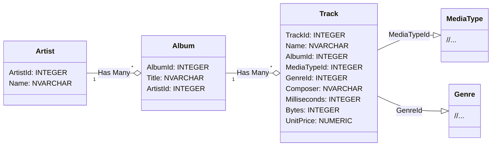
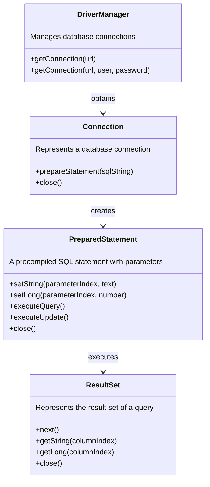

> [!NOTE]
> The English translation for this exercise can be found in [this file](./readme.en.md).

# SQL-tietokantojen käyttö Javasta käsin


Tässä tehtävässä opettelemme muodostamaan yhteyden tietokantaan Java-ohjelmasta käsin ja tekemään yksinkertaisia CRUD-toimenpiteitä (Create, Read, Update & Delete). Tutustumme samalla käsitteisiin kuten JDBC, DAO ja PreparedStatement.

## Tehtävän aloittaminen

Forkkaa ensin tämä repositorio omaan GitHub-repositorioosi GitHubin **Fork**-painikkeella ja kloonaa vasta sitten oma forkkisi koneellesi:

```sh
git clone https://github.com/<oma-github-tunnuksesi>/7-sql-databases.git
```

Avaa kloonattu projekti koodieditorissasi.

## Testaaminen

Tehtävän osille on valmiit [JUnit](https://junit.org/)-yksikkötestit hakemistossa [src/test/java](./src/test/java/). Kunkin osan kohdalla kerrotaan, millä testiluokalla se arvioidaan. Voit ajaa testit koodieditorisi testaustyökalulla ([VS Code](https://code.visualstudio.com/docs/java/java-testing), [Eclipse](https://www.vogella.com/tutorials/JUnitEclipse/article.html)) tai [Gradlella](https://docs.gradle.org/current/userguide/java_testing.html), esimerkiksi:

```
./gradlew test --tests JdbcDemoMainTest        # unix
.\gradlew.bat test --tests JdbcDemoMainTest    # windows
```

Lisää komennon loppuun `--info`, jos haluat tarkemmat tiedot epäonnistuneista testeistä. Testien tekniseen toteutukseen ei tarvitse perehtyä, ja voit kokeilla ratkaisuasi myös omalla `main`-metodilla. Saat kirjoittaa omia testejä lisää, mutta älä muuta tai poista valmiita testejä.

Älä muuta valmiiden luokkien, metodien ja konstruktorien nimiä, parametreja tai paluuarvojen tyyppejä, sillä silloin testit eivät käänny. Saat tiedoston alkuperäisen version takaisin komennolla `git restore <tiedoston polku>` tai kurssijärjestelmän **Palauta lähtökoodi** -toiminnolla.

💡 *Testeissä käytetään eri tietokantaa kuin pääohjelmassa. Tutustu tarvittaessa [TestUtils](./src/test/java/databases/utils/TestUtils.java)-luokkaan ja sen tietokannan luontikäskyihin.*

## Palauttaminen ja pisteet

Jokaisella tehtävän osalla on kurssijärjestelmässä (https://jtjuslin.kapsi.fi/java) oma sivunsa, jonka koodikentissä on osan koodipohja. Kopioi ratkaisusi koodikenttiin tai kirjoita se suoraan niihin. **Testaa ilman palautusta** ajaa osan testit tallentamatta pisteitä, ja **Lähetä** palauttaa ratkaisun. Jokainen testiluokka hyväksytään vain, jos sen kaikki testit menevät läpi, ja pisteet jaetaan hyväksyttyjen testiluokkien mukaan.

**Pisteet kahdessa vaiheessa**

1. Kun ratkaisusi menee läpi kurssijärjestelmässä, saat osasta **puolet pisteistä**.
2. Pushaa lopuksi kaikki julkiseen GitHub-repositorioosi. Paina tämän jälkeen osan sivulla **Lähetä tarkistettavaksi** -nappia. Kun testit menevät läpi, saat osasta **täydet pisteet**. Repositorio saa jäädä julkiseksi.

GitHubissa ei ole arvioivaa YAML-tehtävävirtaa (GitHub Actions -workflowta), eikä `git push` käynnistä arviointia. Kun painat **Lähetä tarkistettavaksi**, kurssijärjestelmän botti hakee koodisi repositoriostasi ja tarkistaa sen samoilla testeillä. Molemmat vaiheet pitää tehdä ennen luvun määräaikaa. Voit lähettää ratkaisusi niin monta kertaa kuin tarvitset, ja voimaan jää paras tulos.


## JDBC – Java Database Connectivity

Javan standardikirjaston [JDBC-ohjelmointirajapinta](https://docs.oracle.com/javase/8/docs/technotes/guides/jdbc/) mahdollistaa Java-sovellusten yhdistämisen SQL-tietokantoihin sekä kyselyiden ja päivitysten tekemisen Java-koodista. Eri tietokantoja käytetään niille toteutettujen ajureiden avulla, joten Java-koodin näkökulmasta ei ole eroa, onko tietokanta esimerkiksi [MySQL](https://www.mysql.com/), [PostgreSQL](https://www.postgresql.org/) vai [SQLite](https://www.sqlite.org/index.html).

Tässä tehtävässä käytetään oletuksena tiedostopohjaista **SQLite**-tietokantaa, joka ei tarvitse erillistä tietokantapalvelinta, verkkoyhteyksiä, salasanoja eikä asennuksia. SQLite "sulautetaan" (embed) osaksi omaa sovellusta:

> *"In contrast to many other database management systems, SQLite is not a client–server database engine. Rather, it is embedded into the end program."*
>
> [https://en.wikipedia.org/wiki/SQLite](https://en.wikipedia.org/wiki/SQLite)

SQLite toimii Java-ohjelman näkökulmasta samalla tavalla kuin tietokantapalvelimet, ja SQL-kyselyt ovat pääosin samat, esimerkiksi `SELECT ArtistId, Name FROM Artist`. Se on keveydestään huolimatta erittäin merkityksellinen tietokanta, jota [käytetään muun muassa suosituimmissa verkkoselaimissa ja puhelimissa](https://www.sqlite.org/famous.html).

⭐ *Voit halutessasi käyttää SQLiten sijaan **MySQL**-tietokantaa, jos pystyt asentamaan palvelimen ja luomaan tietokannan itseohjautuvasti, sillä kurssi voi ohjata siinä vain rajallisesti. Tietokannan luontiskriptit ovat tiedostossa [data/Chinook_MySql_AutoIncrementPKs.sql](./data/Chinook_MySql_AutoIncrementPKs.sql). Poista silloin kommenttimerkit MySQL-ajurin rivin alusta [build.gradle](./build.gradle)-tiedostossa ja vaihda pääohjelman yhteysosoite tunnuksineen vastaamaan omaa tietokantaasi.*

### Ajurit ja riippuvuudet

JDBC-ajurit, kuten muutkin riippuvuudet, voitaisiin ladata verkosta itse, mutta riippuvuuksien hallinta on paljon helpompaa automaatiotyökalulla, kuten Gradlella. SQLite- ja MySQL-ajurit on määritetty valmiiksi [build.gradle](./build.gradle)-tiedostoon, josta koodieditorisi osaa asentaa ne:

```groovy
dependencies {
    // SQLite driver: https://mvnrepository.com/artifact/org.xerial/sqlite-jdbc
    implementation 'org.xerial:sqlite-jdbc:3.+'

    // SQLite driver requires a SLF4J logger https://mvnrepository.com/artifact/org.slf4j/slf4j-simple
    implementation 'org.slf4j:slf4j-simple:2.+'

    // MySQL driver: https://mvnrepository.com/artifact/com.mysql/mysql-connector-j
    // Uncomment the following line, if you wish to use a MySQL database:
    // implementation 'com.mysql:mysql-connector-j:8.+'
}
```


## Valmis musiikkitietokanta

Tehtävässä käytetään valmista [**Chinook**](https://github.com/lerocha/chinook-database)-musiikkitietokantaa, jonka tiedostot ovat tehtäväpohjan [data](./data/)-hakemistossa:

> *"The Chinook data model represents a digital media store, including tables for artists, albums, media tracks, invoices and customers."*
>
> [Luis Rocha, Chinook Database](https://github.com/lerocha/chinook-database)

Tietokannassa on paljon tauluja ja dataa, mutta tässä harjoituksessa käytetään vain `Artist`- ja `Album`-tauluja:



💡 *Voit tutkia tietokannan sisältöä [SQLite-komentorivityökalulla](https://sqlite.org/cli.html) tai jollain [graafisella käyttöliittymällä](https://www.google.com/search?q=sqlite+gui). Jos muutat tietokantatiedostoa vahingossa, saat sen takaisin komennolla `git restore data/TIEDOSTONIMI` (Windowsissa `\` kauttaviivan tilalle).*

Lisätietoja: [UML-kaavio](https://github.com/lerocha/chinook-database/wiki/Chinook-Schema), [dokumentaatio](https://github.com/lerocha/chinook-database), [SQL-luontikäskyt](https://raw.githubusercontent.com/lerocha/chinook-database/master/ChinookDatabase/DataSources/Chinook_Sqlite.sql).


## JDBC:n perusteet

Tietokantaoperaatiot tehdään JDBC:ssä kolmen keskeisen luokan avulla:

* **[Connection](https://docs.oracle.com/javase/8/docs/api/java/sql/Connection.html)** eli yhteys mahdollistaa sovelluksen ja tietokannan välisen vuorovaikutuksen. Yhteyden muodostus vaatii tietokannan tiedot, kuten SQLite-tiedoston sijainnin tai palvelimen osoitteen, käyttäjätunnuksen ja salasanan. Yhteys suljetaan käytön jälkeen, jotta sen resurssit vapautuvat.
* **[PreparedStatement](https://docs.oracle.com/javase/8/docs/api/java/sql/PreparedStatement.html)** eli SQL-lauseke suorittaa SQL-kyselyitä. Sen avulla kyselyiden parametrit syötetään turvallisesti, mikä estää SQL-injektiot.
* **[ResultSet](https://docs.oracle.com/javase/8/docs/api/java/sql/ResultSet.html)** on kyselyn tulosjoukko, jonka tiedot ovat riveinä ja sarakkeina. Se käydään tavallisesti läpi silmukassa.



Resurssien sulkeminen "käsin" `close()`-metodilla vaatii monta koodiriviä. 🚀 *Voit sen sijaan käyttää [try-with-resources](https://www.baeldung.com/java-try-with-resources)-syntaksia, joka sulkee resurssit automaattisesti.*


## Osa 1: kyselyn luonti ja tulosten käsittely *(perusteet, 20 %)*

Tehtäväpohjan pääohjelma [JdbcDemoMain](./src/main/java/databases/part01/JdbcDemoMain.java) havainnollistaa, miten yhteys muodostetaan ja miten sen avulla suoritetaan kyselyitä. Suorita se koodieditorisi Run-painikkeella tai komennolla `./gradlew run` (Windowsissa `.\gradlew.bat run`). Ohjelma tulostaa tietokannan artistit `ArtistId`:n mukaan järjestettynä:

```
AC/DC
Accept
Aerosmith
Alanis Morissette
Alice In Chains
...
```

💡 *Jos VS Code antaa virheen `SQLException: path to 'data/Chinook_Sqlite.sqlite' does not exist`, avaa projekti uudelleen "Open Folder..." -valikosta. Tietokannan polku on suhteellinen projektin päähakemistoon, joten VS Codessa pitää olla auki hakemisto, jossa tämä readme.md on.*

Tee pääohjelmaan kaksi muutosta:

1. **Kysely:** muuta kyselyä niin, että artistit järjestetään nimen mukaan aakkosjärjestykseen.
2. **Tulosjoukon käsittely:** tulosta jokaisen artistin nimen perään samalle riville myös artistin id muodossa `Nimi (id)`:

```
A Cor Do Som (43)
AC/DC (1)
Aaron Copland & London Symphony Orchestra (230)
Aaron Goldberg (202)
Academy of St. Martin in the Fields & Sir Neville Marriner (214)
```

Arvioinnissa ajetaan testiluokka [JdbcDemoMainTest](./src/test/java/databases/part01/JdbcDemoMainTest.java), joka ajaa `main`-metodin ja tutkii sen tulostetta.

`System.out.println`-kutsuihin perustuvaa logiikkaa on hankala testata ja käyttää uudelleen, koska `main`-metodi ei palauta mitään. Parempi tapa on eristää logiikka omiin metodeihinsa, kuten seuraavassa osassa tehdään. Se tekee koodista **testattavampaa**, **uudelleenkäytettävämpää** ja **ylläpidettävämpää**.

🚀 *SQLite järjestää oletuksena "AC/DC":n ennen "Aaron..."-alkuisia nimiä, koska sen ORDER BY -vertailu on kirjainkoosta riippuvainen. Tämä "lähes oikea" järjestys kelpaa, mutta voit halutessasi järjestää nimet kirjainkoosta riippumatta [tämän keskustelun](https://stackoverflow.com/a/2413833) vinkeillä.*


## Osa 2: olioihin perustuva lähestymistapa *(perusteet, 40 %)*

Tässä osassa jaat tietokantaa käyttävät operaatiot olio-ohjelmoinnin keinoin erillisiin luokkiin ja metodeihin. Tietokantalogiikka eriytetään muusta koodista usein [suunnittelumallilla](https://en.wikipedia.org/wiki/Software_design_pattern) nimeltä DAO:

> *"A Data Access Object class can provide access to a particular data resource without coupling the resource's API to the business logic."*
>
> Oracle. Data Access Object - Also Known As DAO. https://www.oracle.com/java/technologies/data-access-object.html

Paketissa [databases.part02](./src/main/java/databases/part02/) on valmiina kolme luokkaa:

* [Artist](./src/main/java/databases/part02/Artist.java) edustaa yksittäistä artistia. Se on "aivan tavallinen" luokka ilman tietokanta- tai käyttöliittymälogiikkaa (*model* tai *entity*).
* [ArtistDAO](./src/main/java/databases/part02/ArtistDAO.java) välittää sovelluksen ja tietokannan välillä: se tarjoaa artisteihin liittyvät tietokantaoperaatiot, joten muiden luokkien ei tarvitse tuntea SQL:ää. DAO-luokassa ei ole käyttöliittymälogiikkaa, kuten tulosteita.
* [ArtistAppMain](./src/main/java/databases/part02/ArtistAppMain.java) on uusi pääohjelma, joka vastaa osan 1 ohjelmaa mutta käyttää `ArtistDAO`-luokkaa eikä sisällä lainkaan tietokantalogiikkaa:

```java
public static void main(String[] args) {
    ArtistDAO artistDAO = new ArtistDAO(JDBC_URL);
    List<Artist> artists = artistDAO.getArtists();

    for (Artist artist : artists) {
        System.out.println(artist.getName() + " (" + artist.getId() + ")");
    }
}
```

Toteuta `ArtistDAO`-luokan metodit `getArtists` ja `getArtistById`, joiden otsikot ja Javadoc-kommentit ovat valmiina. Käytä konstruktorissa annettua yhteysosoitetta (`connectionString`), sillä testit käyttävät omaa testitietokantaansa. Kun DAO toimii, `ArtistAppMain` tulostaa saman kuin osan 1 ohjelma.

💡 *Vältä toistamasta samaa koodia molemmissa metodeissa. Saat toteuttaa myös omia luokkia ja apumetodeja, esimerkiksi `Database`-luokan yhteyksien avaamiseen ja sulkemiseen, ja `getArtistById` saa kutsua `getArtists`-metodia (tehokkuudella ei ole tässä painoarvoa).*

Arvioinnissa ajetaan testiluokka [ArtistDAOTest](./src/test/java/databases/part02/ArtistDAOTest.java).


## Osa 3: tiedon lisääminen, päivittäminen ja poistaminen *(soveltaminen, 40 %)*

Edellisissä osissa tietoa haettiin `executeQuery`-metodilla. Nyt tietoa lisätään, päivitetään ja poistetaan [executeUpdate](https://docs.oracle.com/javase/8/docs/api/java/sql/PreparedStatement.html#executeUpdate--)-metodilla. Paketin [databases.part03](./src/main/java/databases/part03/) luokat [Album](./src/main/java/databases/part03/Album.java) ja [AlbumDAO](./src/main/java/databases/part03/AlbumDAO.java) noudattavat samaa mallia kuin `Artist` ja `ArtistDAO`. Toteuta `AlbumDAO`-luokan metodit niiden kommenttien mukaisesti:

* `getAlbumsByArtist(Artist artist)`
* `addAlbum(Album album)`
* `updateAlbum(Album album)`
* `deleteAlbum(Album album)`

**SQL-injektiot ja tietoturva.** SQL-kyselyiden muodostaminen merkkijonoja yhdistelemällä aiheuttaa tietoturvaongelmia, kuten [tämä auton rekisterikilpi](https://hackaday.com/wp-content/uploads/2014/04/18mpenleoksq8jpg.jpg) ja oheinen sarjakuva havainnollistavat:

[](https://xkcd.com/327/)

*Kuva: Randall Munroe. Exploits of a Mom. [https://xkcd.com/327/](https://xkcd.com/327/). [CC BY-NC 2.5](https://creativecommons.org/licenses/by-nc/2.5/)*

Käytä siis aina `PreparedStatement`-luokkaa ja sen `setString`-, `setLong`- ja muita `set...`-metodeja, kun lisäät kyselyihin parametreja. Ne huolehtivat siitä, että annettua dataa käsitellään vain datana eikä osana kyselyä, joten myös erikoismerkkejä sisältävät nimet tallentuvat oikein.

Albumeille ei ole valmista pääohjelmaa, mutta voit tehdä oman tai muokata edellisen osan ohjelmaa.

Arvioinnissa ajetaan testiluokka [AlbumDAOTest](./src/test/java/databases/part03/AlbumDAOTest.java). Se alustaa testitietokannan aina samaan alkutilaan ennen testejä, mutta sen voi ajaa kuten muutkin testit.


## 🚀 Pro task: ympäristömuuttujan hyödyntäminen

Samaa koodia suoritetaan usein monissa ympäristöissä: kehittäjien omilla koneilla sekä testaus-, staging- ja tuotantoympäristöissä, joissa käytetään eri tietokantoja ja asetuksia. Ympäristökohtaisia asetuksia ei kirjoiteta ohjelmakoodiin, jottei koodia tarvitse muuttaa jokaista ympäristöä varten, eikä käyttäjätunnuksia, salasanoja tai API-avaimia tallenneta koodiin tai versionhallintaan tietoturvasyistä.

Yleinen ratkaisu on asettaa vaihtuvat ja salaiset arvot käyttöjärjestelmän ympäristömuuttujiin, joita Java lukee `System.getenv`-metodilla:

```diff
+ // merkkijono luetaan DATABASE-nimisestä ympäristömuuttujasta: 👍
+ private static final String JDBC_URL = System.getenv("DATABASE");

- // kovakoodattu yhteysosoite, jossa ympäristökohtainen osoite ja selkokielinen salasana: 😱
- private static final String JDBC_URL = "jdbc:mysql://localhost:3306/Chinook?user=root&password=ThisPasswordWillLeak";
```

VS Codessa ympäristömuuttujan voi asettaa ["Run and debug" -asetuksissa](https://code.visualstudio.com/docs/java/java-debugging#_configuration-options) (kohta `env`) ja Eclipsessä [tämän Stack Overflow -ketjun](https://stackoverflow.com/a/12810433) ohjeilla. Ympäristömuuttujia voi asettaa myös koko järjestelmän tasolla [Windowsissa](https://www.google.com/search?q=windows+set+environment+variable), [Linuxissa](https://www.google.com/search?q=linux+set+environment+variable) ja [macOS:ssä](https://www.google.com/search?q=macos+set+environment+variable).


## Lisenssi ja tekijät

Tämän tehtävän ovat kehittäneet Teemu Havulinna ja Jukka Juslin, ja se on lisensoitu [Creative Commons BY-NC-SA -lisenssillä](https://creativecommons.org/licenses/by-nc-sa/4.0/). Tehtävänannon, lähdekoodien ja testien toteutuksessa on hyödynnetty ChatGPT 3.5 -kielimallia sekä GitHub Copilot -tekoälyavustinta.

**Chinook-tietokanta.** Tietokannan on luonut [Luis Rocha](https://github.com/lerocha), ja se on lisensoitu [MIT-lisenssillä](https://github.com/lerocha/chinook-database/blob/master/LICENSE.md).

**SQLite-ajuri.** [Apache License](https://github.com/xerial/sqlite-jdbc/blob/master/LICENSE).

**MySQL-ajuri.** [Preface and Legal Notices](https://dev.mysql.com/doc/connector-j/en/preface.html).
